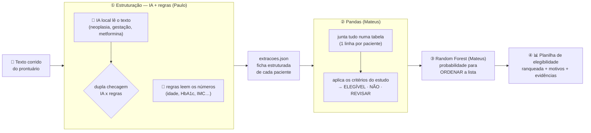

<div align="center">

# 🩺 CLINIA

### Triagem inteligente de pacientes para pesquisa clínica

*"Enquanto você lê um, a CLINIA leu todos."*


2º lugar no Ideathon do 3º ConSaúde (UFPE + HC-UFPE) · Pré-incubação i.de.i.a.S (Senac PE)

</div>

---

## O que é

Nos hospitais universitários, boa parte da informação do paciente está em **texto corrido** no prontuário (AGHUx). Para achar candidatos a uma pesquisa clínica, o coordenador lê prontuário por prontuário.

A **CLINIA lê o texto de todos os pacientes**, monta uma **ficha estruturada** de cada um, aplica os critérios do estudo e devolve uma **lista ranqueada**, com o **trecho do prontuário** que justifica cada conclusão.

> **A decisão final é sempre humana.** Na dúvida, a CLINIA não decide: manda para revisão.

## Veja funcionando

```text
$ python -m ia.demo --texto "Masc, 63a, DM2 + HAS. Lab: A1c 8,4 | GJ 190 | Cr 1,0 | IMC 30,1.
                             Em QT para Ca de pulmão desde julho. MTF suspensa pela oncologia."

  Ficha lida do texto
    Idade                63           ← "63a"
    Sexo                 M            ← "Masc"
    HbA1c (%)            8,4          ← "A1c 8,4"
    Creatinina (mg/dL)   1            ← "Cr 1,0"
    Glicemia de jejum    190          ← "GJ 190"
    IMC                  30,1         ← "IMC 30,1"

  Critérios lidos do texto
    Neoplasia ativa      INCERTO        ✔ trecho conferido
      ← "QT para Ca de pulmão desde julho"
    Gestação atual       não mencionado
    Usa metformina       NÃO            ✔ trecho conferido
      ← "MTF suspensa pela oncologia"

  → VAI PARA REVISÃO HUMANA
      · Neoplasia ativa: leituras divergentes: IA = não tem, regras = tem

  A decisão final é sempre do coordenador/médico.
```

Aqui a IA errou sozinha, as regras discordaram, e a CLINIA chamou o humano. **É assim que ela foi feita para funcionar.**

## Como funciona

São **4 etapas**. As duas primeiras são do Paulo, as duas últimas do Mateus:



| Etapa | Ferramenta | O que acontece | Exemplo |
|---|---|---|---|
| **① Estruturação** | IA local (Ollama) + regex | O texto corrido vira uma **ficha estruturada**, com o trecho que justifica cada campo | "Masc, 63a… Em QT para Ca de pulmão" → idade 63, sexo M, neoplasia ativa: SIM |
| **② Pandas** | Pandas (tabelas em Python) | **Junta** as fichas numa tabela e **aplica os critérios do estudo** a cada paciente | idade 63 ✔ (30–70) · HbA1c 8,4 ✔ (7–10,5) · neoplasia ativa ✘ → **NÃO ELEGÍVEL**, motivo: "neoplasia ativa" |
| **③ Random Forest** | scikit-learn | Dá uma **probabilidade** para cada paciente, usada só para **ordenar** quem aparece primeiro. Não muda o resultado da etapa ② | entre os ELEGÍVEIS, quem tem 0,92 aparece antes de quem tem 0,61 |
| **④ Planilha** | Pandas → Excel | Gera a **planilha de elegibilidade**: posição, resultado, probabilidade, critérios atendidos, critérios que barraram e os trechos do texto | `planilha_resultado.xlsx` |

> **Por que os critérios ficam no Pandas e não na IA?** Porque regra fixa sempre dá o mesmo resultado e mostra o porquê ("HbA1c 10,8% acima do máximo de 10,5%"). É isso que faz o coordenador confiar. A IA só **lê**; quem **decide** é a regra, e a decisão final é sempre humana.

**Situação hoje:** ① pronta e testada · ②, ③ e ④ em construção (Mateus).

Explicação completa, peça por peça: **[docs/COMO_FUNCIONA.md](docs/COMO_FUNCIONA.md)**.

## Resultados (dados fictícios)

Base de prova: 100 pacientes com texto variado (abreviações, erros de digitação, negações, histórico familiar).

| | Só IA | Só regras | **CLINIA (IA + regras)** |
|---|:---:|:---:|:---:|
| **Erros perigosos** | 11 | 19 | **3** |
| Acerto: neoplasia / gestação / metformina | 78 / 88 / 85% | 92 / 98 / 81% | **91 / 92 / 80%** |
| Números lidos errados (idade, HbA1c, IMC…) | — | — | **0** |

⏱️ ~5 s por paciente num notebook comum (RTX 3050), **sem internet e sem custo**.
Detalhes, limites e o que **não** afirmar: [docs/RESULTADOS_EXTRACAO.md](docs/RESULTADOS_EXTRACAO.md).

## Começar

```powershell
git clone git@github.com:mateusbasilio53-cmd/clinia.git
cd clinia
py -3.14 -m venv .venv
.\.venv\Scripts\Activate.ps1
pip install -r requirements.txt

python -m pytest          # 54 passed = tudo certo
python -m ia.demo         # demo com 3 pacientes (funciona mesmo sem a IA instalada)
python -m ia.verificar_pc # qual modelo de IA seu PC aguenta
```

Para a IA ler textos novos, instale o [Ollama](https://ollama.com) e rode `ollama pull qwen2.5:3b` (ou o modelo que o `verificar_pc` recomendar). Passo a passo: **[docs/GUIA_INSTALACAO.md](docs/GUIA_INSTALACAO.md)**.

## Comandos

| Quero… | Comando |
|---|---|
| ver a demo / a IA ler um texto novo | `python -m ia.demo` · `python -m ia.demo --texto "..."` |
| validar uma planilha | `python -m ia.entrada.validar --planilha dados/arquivo.xlsx` |
| ler uma planilha inteira | `python -m ia.extracao.extrator --provedor ollama --planilha dados/arquivo.xlsx` |
| …sem IA, só com o que já foi lido | adicionar `--offline` |
| medir contra o gabarito | `python -m ia.extracao.avaliar --extracoes <json> --planilha <xlsx>` |
| comparar modelos e guardar o histórico | `python -m ia.extracao.experimento --modelos qwen2.5:3b,qwen2.5:7b --conjunto prova` |
| gerar a planilha de saída | `python -m ia.extracao.relatorio --base "Nome\|<xlsx>\|<json>"` |

## Estrutura

| Pasta | O que tem | Dono |
|---|---|---|
| `ia/entrada/` | ler e validar a planilha | Paulo |
| `ia/extracao/` | ① estruturação: IA, regex, dupla checagem, verificação, cache, avaliação | Paulo |
| `ia/dados/` · `ia/regras/` | ② Pandas: juntar a tabela e aplicar os critérios do estudo | Mateus |
| `ia/modelo/` | ③ Random Forest | Mateus |
| `ia/saida/` | ④ planilha de elegibilidade | Mateus |
| `dados/` | planilhas de pacientes **fictícios** | os dois (só leitura) |
| `prompts/` | instruções da IA (versionadas) e casos difíceis | Paulo |
| `contratos/` | formato do `extracoes.json` (Paulo ↔ Mateus) | os dois |
| `entregas/` | resultados prontos para o Mateus | Paulo → Mateus |
| `avaliacao/` | bases de teste, histórico de medições, base de estudo | os dois |
| `cache/` | respostas da IA já calculadas (modo offline) | automático |
| `docs/` | explicações, decisões, resultados, guias | os dois |

## Documentação

| Documento | Para quê |
|---|---|
| 📘 [Como funciona](docs/COMO_FUNCIONA.md) | **comece por aqui:** o sistema explicado do zero |
| 📊 [Resultados](docs/RESULTADOS_EXTRACAO.md) | números oficiais e frases para a apresentação |
| 🛠️ [Guia de instalação](docs/GUIA_INSTALACAO.md) | do zero até a IA rodando no seu PC |
| 🤝 [Para o Mateus](docs/PARA_O_MATEUS.md) | o que está pronto e como usar na parte dele |
| 🧪 [Avaliação](avaliacao/README.md) | como medir, comparar modelos e melhorar sem "colar na prova" |
| 🧭 [Decisões](docs/DECISOES.md) | cada decisão, quando, por quem e por quê |
| 🗺️ [Playbook do MVP](CLINIA_MVP_PLAYBOOK.md) · [Divisão de tarefas](CLINIA_DIVISAO_TAREFAS.md) | o plano completo |

## Equipe

| | Papel |
|---|---|
| **Paulo Francisco de Moura Neto** | cofundador, líder técnico · entrada e IA |
| **Mateus Basílio** | Pandas (tabela e critérios), Random Forest e planilha de elegibilidade |
| **Pedro** e **Matheus Andrade** | apresentação do MVP |
| Equipe de pesquisa clínica da **Bárbara** | validação clínica |

## Privacidade

- **Só dados fictícios** neste repositório. Nenhum dado real de paciente.
- A IA roda **no próprio computador**: o texto não vai para a internet.
- Pacientes são identificados por pseudônimo (`PAC-001`), nunca por nome.
- Chaves de API ficam em `.env`, que nunca vai para o git.
